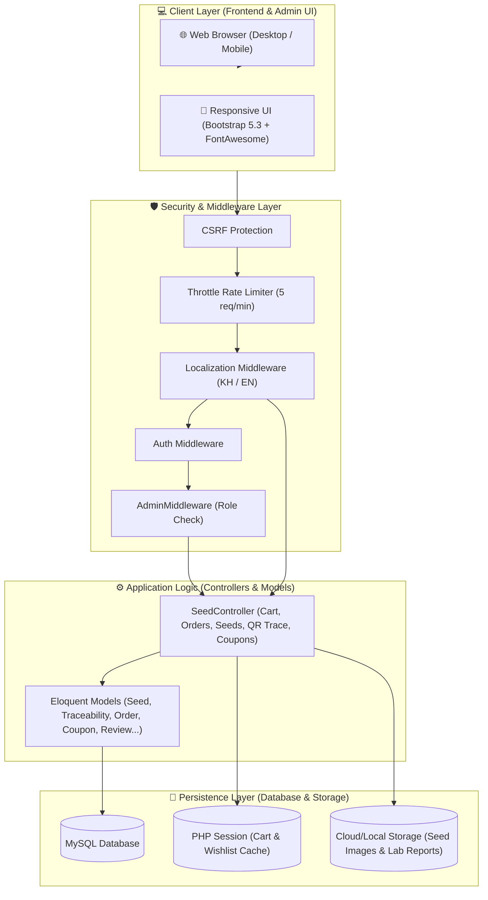
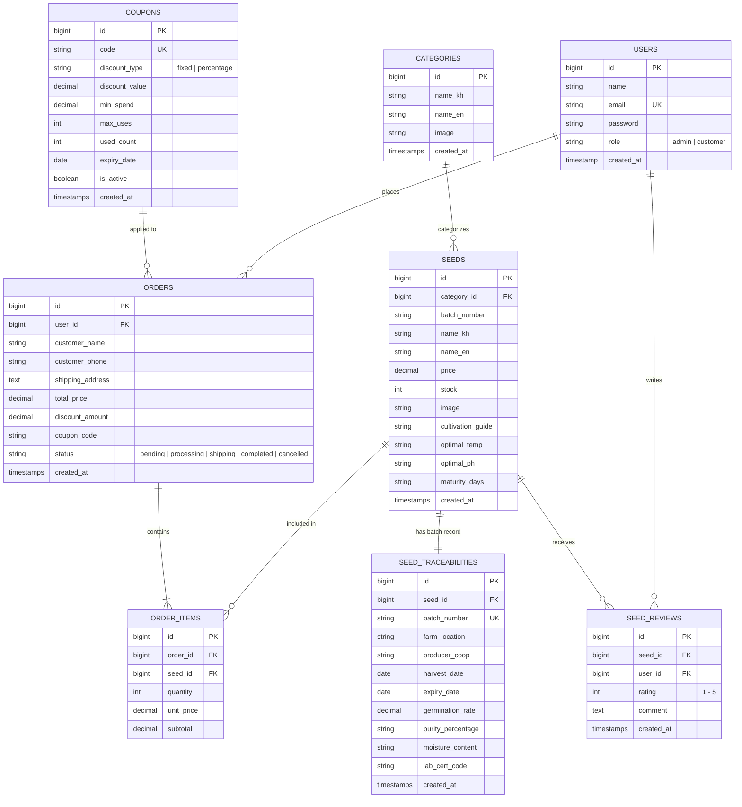

# 🏛️ ស្ថាបត្យកម្មប្រព័ន្ធ (System Architecture)
### Smart Agro-Seed Marketplace (Grow2Growth)

---

## ១. ទិដ្ឋភាពទូទៅនៃស្ថាបត្យកម្ម (Architecture Overview)

ប្រព័ន្ធ **Smart Agro-Seed Marketplace** ត្រូវបានបង្កើតឡើងតាមទម្រង់ **MVC (Model - View - Controller)** លើគ្រោងការងារ **Laravel 11.x Framework** ដែលមានលក្ខណៈ Monolithic Modular រួមបញ្ចូលគ្នារវាង Frontend User Interface, RESTful Cart/Wishlist APIs, និង Admin Control Panel យ៉ាងមានសុវត្ថិភាព និងប្រសិទ្ធភាពខ្ពស់។



---

## ២. បច្ចេកវិទ្យាស្នូលដែលប្រើប្រាស់ (Core Technology Stack)

| ស្រទាប់ (Layer) | បច្ចេកវិទ្យា (Technology) | កំណែ (Version) | តួនាទី និងសារៈសំខាន់ (Role & Justification) |
|---|---|---|---|
| **Backend Core** | PHP | `8.2+` | ភាសាស្នូលដែលផ្តល់នូវល្បឿន Type-safe និង Performance ខ្ពស់ |
| **Framework** | Laravel | `11.x` | Modern PHP Framework ជាមួយ Eloquent ORM, Blade, Routing & Testing Suite |
| **Database** | MySQL / MariaDB | `8.0+` | Relational Database គ្រប់គ្រងទិន្នន័យគ្រាប់ពូជ បាច់ផលិតកម្ម និងការកម្ម៉ង់ |
| **Frontend Templating**| Blade Template | Native | Server-Side Rendering (SSR) លឿនរហ័ស ងាយស្រួលធ្វើ SEO និងសុវត្ថិភាពខ្ពស់ |
| **UI Framework** | Bootstrap | `5.3.0` | ប្រព័ន្ធ Grid និង Responsive Components គាំទ្រទាំងទូរស័ព្ទ និងកុំព្យូទ័រ |
| **Typography** | Kantumruy Pro & Koh Santepheap | Google Fonts | ពុម្ពអក្សរខ្មែរទំនើប មានដង្ហើមស្អាត ងាយស្រួលអាន គាំទ្រទម្ងន់ 300 ដល់ 700 |
| **Icons Library** | FontAwesome Free | `6.4.0` | រូបតំណាងច្បាស់លាស់សម្រាប់កសិកម្ម និង eCommerce |
| **Alerts & Modals** | SweetAlert2 | `11` | ផ្ទាំង Dialog លេចឡើងប្រកបដោយវិជ្ជាជីវៈ (Toast alerts & Confirmations) |
| **Testing Harness** | PHPUnit | `11.x` | ឈុតតេស្តស្វ័យប្រវត្ត Automated Unit & Feature Testing |
| **Code Formatter** | Laravel Pint | `1.x` | ឧបករណ៍ត្រួតពិនិត្យ និងកែទម្រង់កូដតាមស្តង់ដារ PSR-12 |

---

## ៣. រចនាសម្ព័ន្ធទិន្នន័យ និងទំនាក់ទំនង (Database Schema & Model Relationships)

ប្រព័ន្ធមានតារាងទិន្នន័យចម្បងចំនួន **៨ តារាង** ដែលមានទំនាក់ទំនងគ្នាទៅវិញទៅមកយ៉ាងរឹងមាំ៖



---

## ៤. ស្រទាប់សុវត្ថិភាព និងការគ្រប់គ្រងសិទ្ធិ (Security Architecture)

1. **Role-Based Access Control (RBAC)**:
   - ប្រើប្រាស់ `App\Http\Middleware\AdminMiddleware` ដើម្បីការពាររាល់ Route ដែលចាប់ផ្តើមដោយ `/admin/*`។ បើអ្នកប្រើប្រាស់មិនមែនជា `admin` ទេ វានឹងរុញត្រឡប់ទៅទំព័រដើមភ្លាមៗ (`redirect('/')`) ជាមួយសារព្រមាន។
2. **Brute-Force Attack Protection**:
   - Route `/login` ត្រូវបានការពារដោយ Rate Limiting Middleware `throttle:5,1` (អនុញ្ញាតឱ្យសាកល្បងបញ្ចូល Password ខុសត្រឹម ៥ ដងក្នុង ១ នាទី)។
3. **Cross-Site Request Forgery (CSRF)**:
   - គ្រប់ Form ទាំងអស់ (POST, PUT, PATCH, DELETE) តម្រូវឱ្យមាន `@csrf` Token ជាកាតព្វកិច្ច។ ការហៅ Fetch API លើ JavaScript ក៏ភ្ជាប់ `X-CSRF-TOKEN` Header ជានិច្ច។
4. **SQL Injection Prevention**:
   - ប្រើប្រាស់ Laravel Eloquent ORM និង PDO Parameter Binding ១០០% គ្មានការប្រើ Raw Concatenated SQL ឡើយ។
5. **Database Transactions**:
   - ក្នុងដំណើរការ Checkout បញ្ជាទិញ ការកាត់ស្តុកគ្រាប់ពូជ និងការបង្កើតវិក្កយបត្រ ដំណើរការនៅក្នុង `DB::transaction()`។ ប្រសិនបើមានបញ្ហា error កើតឡើងនៅជំហានណាមួយ ប្រព័ន្ធនឹង Rollback ទិន្នន័យទាំងអស់ត្រឡប់មកដើមវិញភ្លាមៗ។

---

## ៥. រចនាសម្ព័ន្ធថតសំខាន់ៗក្នុងគម្រោង (Directory Layout)

```
smart-agro/
├── app/
│   ├── Http/
│   │   ├── Controllers/
│   │   │   └── SeedController.php   # Controller ចម្បងគ្រប់គ្រង Logic ទាំងមូល
│   │   └── Middleware/
│   │       └── AdminMiddleware.php  # Middleware ការពារសិទ្ធិ Admin
│   └── Models/                      # Eloquent ORM Models ទាំង ៨
├── config/                          # Configuration (app.php, database.php...)
├── database/
│   ├── migrations/                  # ឯកសារបង្កើតតារាង Database
│   └── seeders/                     # ទិន្នន័យគំរូសាកល្បង (Seeds, Categories...)
├── docs/                            # មជ្ឈមណ្ឌលឯកសារបច្ចេកទេសគម្រោង
├── public/
│   ├── css/                         # Custom CSS (home-style.css, admin-style.css)
│   └── images/                      # រូបភាពគ្រាប់ពូជ និង Logo
├── resources/
│   └── views/                       # Blade Views (Frontend, Admin, Layouts)
├── routes/
│   └── web.php                      # Web Route Definitions
└── tests/
    └── Feature/
        └── SmartAgroTest.php        # ឈុតតេស្ត Feature Tests ចំនួន ៣៧ តេស្ត
```

