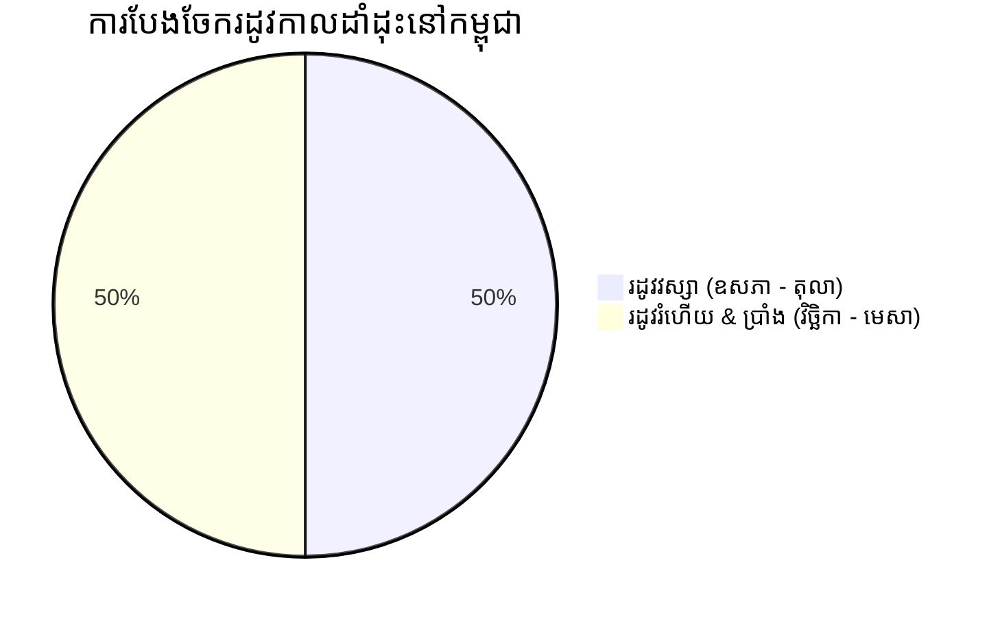

# 🌾 ចំណេះដឹងវិស័យកសិកម្ម និងស្តង់ដារគ្រាប់ពូជ (Agricultural Domain & Seed Standards)
### Smart Agro-Seed Marketplace (Grow2Growth)

---

## ១. ប្រវត្តិសហគមន៍ដៃគូ (Partner Farm & Cooperative Profile)

* **ឈ្មោះដៃគូផលិត**៖ សហគមន៍កសិកម្មកសិដ្ឋានតាក្រាម (Takram Organic Farm Cooperative)
* **ទីតាំងភូមិសាស្ត្រ**៖ ភូមិតាក្រាម ឃុំតាក្រាម ស្រុកបាណន់ ខេត្តបាត់ដំបង កម្ពុជា
* **លក្ខណៈពិសេសដី**៖ ដីល្បាប់មាត់ស្ទឹងសង្កែ សម្បូរទៅដោយសារធាតុសរីរាង្គធម្មជាតិ ស័ក្តិសមបំផុតសម្រាប់បណ្តុះពូជបន្លែស្លឹក និងបន្លែផ្លែ។
* **បេសកកម្ម**៖ ផលិត និងផ្គត់ផ្គង់គ្រាប់ពូជសុទ្ធមិនកែប្រែហ្សែន (Non-GMO) ធានាអត្រាដំណុះខ្ពស់ ៩៥%+ រួមចំណែកជួយកសិករកាត់បន្ថយថ្លៃដើម និងទទួលបានទិន្នផលខ្ពស់។

---

## ២. រដូវកាលដាំដុះទាំង ៣ នៅកម្ពុជា (Cambodia's 3 Agricultural Seasons)

### ២.១ រដូវវស្សា (Rainy Season: ឧសភា ដល់ តុលា)
* **លក្ខណៈអាកាសធាតុ**៖ ភ្លៀងធ្លាក់ជោកជាំ សំណើមបរិយាកាសខ្ពស់ ($> ៨០\%$) សីតុណ្ហភាព $២៨^\circ\text{C} - ៣៤^\circ\text{C}$។
* **បញ្ហាប្រឈម**៖ ទឹកដក់ រលួយឫស និងជំងឺផ្សិតលើស្លឹក។
* **ដំណាំស័ក្តិសមបំផុត**៖
  - 🥬 **ត្រកួនយកស្លឹក**៖ ដុះលឿន ធន់ទឹកភ្លៀង មិនរលួយគល់
  - 🥒 **ត្រសក់ & ននោង**៖ ដំណាំឡើងទ្រើង ផ្លែមិនប៉ះដីសើម
  - 🌱 **សណ្តែកកួរ**៖ ឫសរឹងមាំ បញ្ចេញផ្កាច្រើនក្នុងរដូវភ្លៀង
  - 🎃 **ល្ពៅ & ត្រឡាច**៖ ស្លឹកក្រាស់ ធន់នឹងដំណក់ទឹកភ្លៀងខ្លាំង

### ២.២ រដូវរំហើយ & ប្រាំង (Cool & Dry: វិច្ឆិកា ដល់ មេសា) — ★ រដូវកាលមាស
* **លក្ខណៈអាកាសធាតុ**៖ មេឃស្រឡះ ពន្លឺថ្ងៃគ្រប់គ្រាន់ យប់ត្រជាក់ សីតុណ្ហភាព $២២^\circ\text{C} - ២៩^\circ\text{C}$។
* **អត្ថប្រយោជន៍**៖ គ្មានភ្លៀងខ្លាំងបំផ្លាញផ្កា សត្វល្អិតតិច ស័ក្តិសមបំផុតសម្រាប់បន្លែតម្លៃខ្ពស់។
* **ដំណាំស័ក្តិសមបំផុត**៖
  - 🥬 **ស្ពៃបូកគោ & ស្ពៃក្តោប**៖ រុំក្បាលណែនល្អ មិនរលួយ
  - 🥗 **សាឡាត់ (Lettuce)**៖ ស្រួយ ផ្អែម មិនជូរ
  - 🥦 **ផ្កាខាត់ណា & ខាត់ណាផ្កាបៃតង (Broccoli)**
  - 🥕 **ការ៉ុត & ឆៃថាវ**៖ ដីស្ងួតល្មមធ្វើឱ្យមើមធំត្រង់ល្អ
  - 🍅 **ប៉េងប៉ោះ**៖ ផ្លែក្រហមល្អ មិនងាយប្រេះសម្បក

### ២.៣ ផ្ទះសំណាញ់វៃឆ្លាត (Greenhouse & Hydroponics: ពេញមួយឆ្នាំ)
* **លក្ខណៈបច្ចេកទេស**៖ គ្រប់គ្រងសីតុណ្ហភាព ពន្លឺ និងសំណើមដោយស្វ័យប្រវត្ត ការពារសត្វល្អិតបាន ១០០% គ្មានការប្រើថ្នាំគីមី។
* **ដំណាំស័ក្តិសម**៖ ប៉េងប៉ោះឆឺរី, ម្ទេសប្លោកផ្អែម, សាឡាត់អ៊ីដ្រូពូនិច, ត្រសក់ផ្អែម (Melon)។

---

## ៣. ស្តង់ដារគុណភាពគ្រាប់ពូជ និងការពិសោធន៍ (Seed Quality Metrics)

| សូចនាករគុណភាព (Quality Metric) | ស្តង់ដារអប្បបរមាជាតិ | ស្តង់ដារកសិដ្ឋានតាក្រាម (Grow2Growth) | ការបកស្រាយបច្ចេកទេស (Explanation) |
|---|:---:|:---:|---|
| **អត្រាដំណុះ (Germination Rate)** | $\ge ៨០\%$ | **$\ge ៩៥\%$** | ក្នុងចំណោម ១០០ គ្រាប់ ត្រូវដុះពន្លកយ៉ាងតិច ៩៥ គ្រាប់ |
| **ភាពសុទ្ធនៃពូជ (Purity)** | $\ge ៩៥\%$ | **$\ge ៩៨.៥\%$** | គ្មានគ្រាប់ស្មៅ ឬកម្ទេចកំទីលាយឡំក្នុងកញ្ចប់ |
| **សំណើមគ្រាប់ (Moisture Content)** | $\le ១២\%$ | **$\le ៨.៥\%$** | សំណើមទាបការពារការដុះផ្សិត និងរក្សាទុកបានយូរ |
| **កម្រិត pH ដីសមស្រប (Optimal pH)** | - | **$៦.០ - ៦.៨$** | កម្រិតអាស៊ីត-បាសដែលឫសស្រូបជីបានល្អបំផុត |

---

## ៤. រូបមន្តគណនាទំហំដី និងបរិមាណគ្រាប់ពូជ (Land & Seed Formulas)

### ៤.១ រូបមន្តគណនាចំនួនកញ្ចប់គ្រាប់ពូជ (Seed Pack Formula)
$$\text{Packs Needed} = \left\lceil \frac{\text{Area in } \text{m}^2}{1000} \times \text{Rate per } 1000\text{m}^2 \right\rceil$$

### ៤.២ តារាងគម្លាតគុម្ព និងទិន្នផលប៉ាន់ស្មានតាមប្រភេទបន្លែ (Crop Spacing Matrix)

| ប្រភេទបន្លែ (Vegetable) | ចំនួនកញ្ចប់/១០០០ម² | គម្លាតគុម្ពដាំដុះ (Spacing) | រយៈពេលប្រមូលផល | ទិន្នផលប៉ាន់ស្មាន/ម² |
|---|:---:|:---:|:---:|:---:|
| 🥬 **ស្ពៃបូកគោ / ស្ពៃក្តោប** | ៣ កញ្ចប់ | 35cm x 40cm | ៥៥ - ៧០ ថ្ងៃ | 1.8 គីឡូក្រាម |
| 🥗 **សាឡាត់ (Lettuce)** | ៤ កញ្ចប់ | 20cm x 25cm | ៣៥ - ៤៥ ថ្ងៃ | 1.2 គីឡូក្រាម |
| 🥒 **ត្រសក់ទ្រើង (Cucumber)** | ២ កញ្ចប់ | 50cm x 100cm | ៤០ - ៥០ ថ្ងៃ | 3.5 គីឡូក្រាម |
| 🍅 **ប៉េងប៉ោះ (Tomato)** | ២ កញ្ចប់ | 40cm x 60cm | ៦០ - ៧៥ ថ្ងៃ | 4.0 គីឡូក្រាម |
| 🌱 **ត្រកួនយកស្លឹក (Morning Glory)**| ៦ កញ្ចប់ | 10cm x 15cm | ២០ - ២៥ ថ្ងៃ | 2.0 គីឡូក្រាម |
| 🌶️ **ម្ទេសហឺរ / ម្ទេសប្លោក** | ២ កញ្ចប់ | 50cm x 50cm | ៧០ - ៨៥ ថ្ងៃ | 2.5 គីឡូក្រាម |

