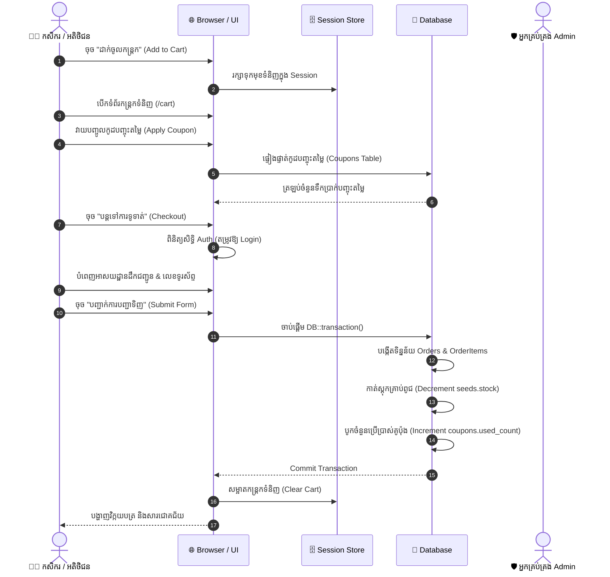
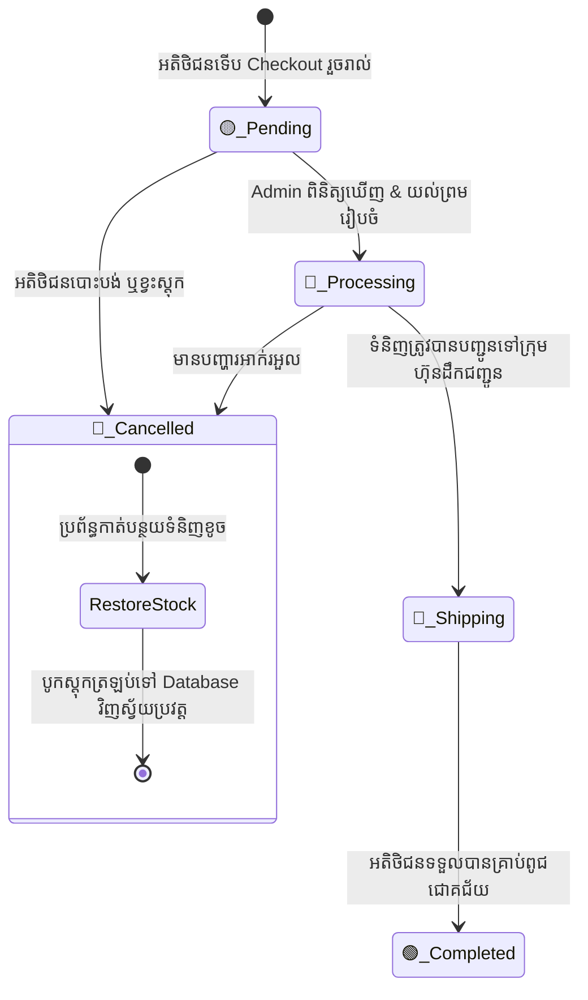
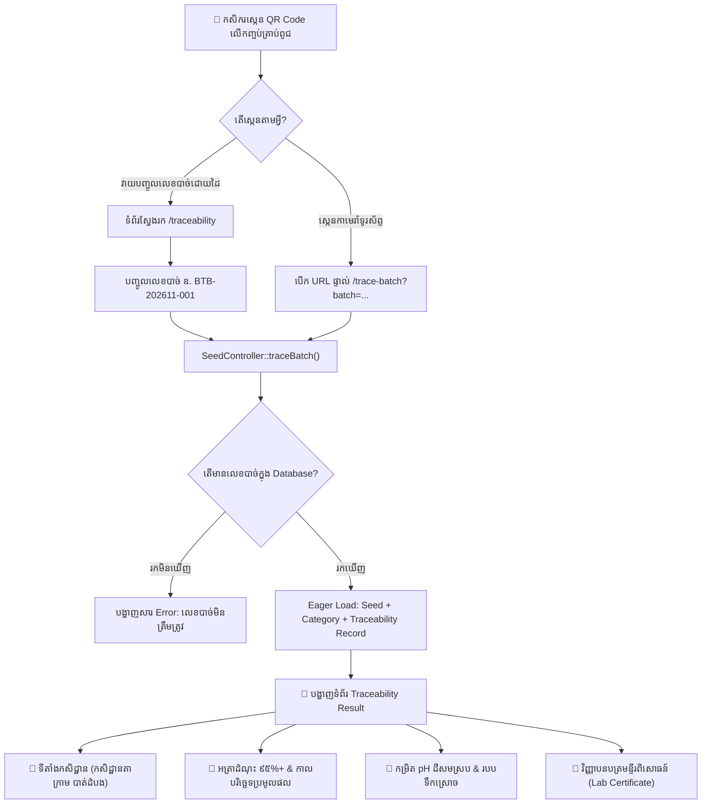

# 🔄 លំហូរការងារ និងដំណើរការប្រព័ន្ធ (System Workflows & Lifecycle Diagrams)
### Smart Agro-Seed Marketplace (Grow2Growth)

---

## ១. លំហូរការទិញ និងទូទាត់ប្រាក់ (Shopping & Checkout Flow)

---

## ២. វដ្តជីវិតនៃស្ថានភាពបញ្ជាទិញ (Order Status Lifecycle)

ស្ថានភាពបញ្ជាទិញរបស់អតិថិជនឆ្លងកាត់ដំណាក់កាលដូចខាងក្រោម៖

### ការពិពណ៌នាអំពីស្ថានភាពនីមួយៗ (Status Details):
* **🟡 Pending (រង់ចាំការពិនិត្យ)**៖ ការបញ្ជាទិញថ្មីទើបត្រូវបានបង្កើតឡើង។
* **🔵 Processing (កំពុងរៀបចំទំនិញ)**៖ ឃ្លាំងកំពុងរៀបចំវេចខ្ចប់គ្រាប់ពូជតាម Packing Manifest។
* **🚚 Shipping (កំពុងដឹកជញ្ជូន)**៖ កញ្ចប់គ្រាប់ពូជត្រូវបានប្រគល់ឱ្យដៃគូដឹកជញ្ជូន (Virak Buntham, J&T, etc.) អមដោយលេខកូដតាមដាន។
* **🟢 Completed (បានបញ្ចប់ជោគជ័យ)**៖ កសិករបានទទួលកញ្ចប់គ្រាប់ពូជត្រឹមត្រូវ។
* **🔴 Cancelled (បានបោះបង់)**៖ ការកម្ម៉ង់ត្រូវបានលុបចោល ហើយ **ស្តុកទំនិញត្រូវបានបូកបញ្ចូលត្រឡប់ទៅឃ្លាំងវិញស្វ័យប្រវត្ត**។

---

## ៣. លំហូរតាមដានប្រភពដើមគ្រាប់ពូជតាម QR Code (Traceability Flow)

---

## ៤. លំហូរការគ្រប់គ្រងគ្រាប់ពូជ & បាច់ផលិតកម្ម (Admin Seed Creation Flow)

ដើម្បីសម្រួលការងាររបស់ Admin ឱ្យមានប្រសិទ្ធភាព ប្រព័ន្ធបានរៀបចំទម្រង់បែប **One-Stop Form**៖

```mermaid
flowchart LR
    A["ចូលទំព័រ /admin/seeds/create"] --> B["បំពេញព័ត៌មានគ្រាប់ពូជ (ឈ្មោះ, ប្រភេទ, តម្លៃ, ស្តុក, រូបភាព)"]
    B --> C["បំពេញព័ត៌មានបាច់កសិកម្ម (លេខបាច់, កសិដ្ឋាន, ថ្ងៃប្រមូលផល, ថ្ងៃផុតកំណត់)"]
    C --> D["ជ្រើសរើស Preset Shortcut ថ្ងៃខែ (+៦ខែ, +១ឆ្នាំ, +១៨ខែ)"]
    D --> E["ប្រព័ន្ធគណនារយៈពេលសុពលភាព (Shelf-life) ស្វ័យប្រវត្ត"]
    E --> F["ចុចរក្សាទុក (Submit Form)"]
    F --> G["DB Transaction: បង្កើត Seed + បង្កើត SeedTraceability ក្នុងពេលតែមួយ"]
    G --> H["ប្រព័ន្ធបង្កើត QR Code Link ស្វ័យប្រវត្ត"]
    H --> I["Admin អាចចុចបោះពុម្ពស្លាក Sticker Packaging Labels ភ្លាមៗ"]
```

---

## ៥. លំហូរការតាមដានការដឹកជញ្ជូនសាធារណៈ (Public Order Tracking Flow)

កសិករ ឬអ្នកទិញមិនចាំបាច់មានគណនី Login ក៏អាចដឹងពីស្ថានភាពកញ្ចប់ទំនិញរបស់ខ្លួនបានដែរ៖

1. ចូលទៅកាន់ `/order-tracking`។
2. វាយបញ្ចូល **លេខទូរស័ព្ទដែលបានកុម្ម៉ង់** (ឧ. `0883322318`) ឬ **លេខកូដវិក្កយបត្រ (Order ID)**។
3. ប្រព័ន្ធនឹងទាញយកព័ត៌មានមកបង្ហាញ៖
   - បញ្ជីគ្រាប់ពូជក្នុងកញ្ចប់
   - ស្ថានភាពបច្ចុប្បន្ន (Timeline ពី Pending ដល់ Completed)
   - អាសយដ្ឋានដឹកជញ្ជូន
   - ឈ្មោះ និងលេខទូរស័ព្ទអ្នកទទួល

