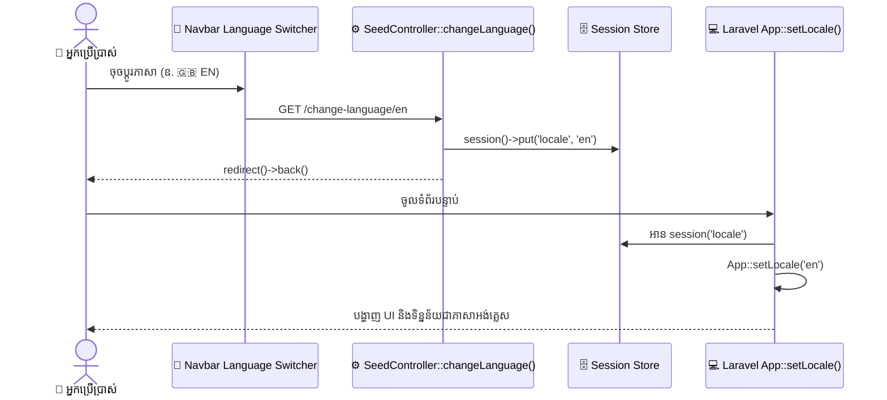

# 🌐 មគ្គុទ្ទេសក៍ការគ្រប់គ្រងពហុភាសា (Multi-Language & Localization Guide)
### Smart Agro-Seed Marketplace (Grow2Growth)

---

## ១. ស្ថាបត្យកម្មពហុភាសា (Localization Architecture)

ប្រព័ន្ធគាំទ្រ **ភាសាខ្មែរ (🇰🇭 KH)** និង **ភាសាអង់គ្លេស (🇬🇧 EN)** យ៉ាងរលូន ដោយបែងចែកការគ្រប់គ្រងភាសាជា ២ ផ្នែក៖
1. **Static UI Translations**: គ្រប់គ្រងតាមរយៈ JSON Language Files (`lang/kh.json` និង `lang/en.json`)។
2. **Dynamic Database Content**: គ្រប់គ្រងតាមរយៈ Dual-Language Columns ក្នុង Database (ឧ. `name_kh` និង `name_en` ក្នុងតារាង `seeds` និង `categories`)។

---

## ២. របៀបដំណើរការប្តូរភាសា (How Locale Switching Works)



### Route & Controller Code:
```php
public function changeLanguage($locale)
{
    if (in_array($locale, ['kh', 'en'])) {
        session()->put('locale', $locale);
    }
    return redirect()->back();
}
```

---

## ៣. ការបង្ហាញទិន្នន័យក្នុង Blade View (Rendering in Blade)

### ៣.១ Static UI Strings (ប្រើ `__()`)
```blade
<!-- ហៅតាមរយៈ Key ក្នុង JSON file -->
<h1>{{ __('banner_title') }}</h1>
<button>{{ __('shop_now') }}</button>
<span>{{ __('cart') ?? 'កន្ត្រក' }}</span>
```

### ៣.២ Dynamic Database Fields
```blade
<!-- ពិនិត្យមើល Locale បច្ចុប្បន្នដើម្បីជ្រើសរើស Column ត្រឹមត្រូវ -->
<h5 class="fw-bold">
    {{ App::isLocale('en') ? $seed->name_en : $seed->name_kh }}
</h5>

<span class="badge bg-light">
    {{ App::isLocale('en') ? $category->name_en : $category->name_kh }}
</span>
```

---

## ៤. របៀបបន្ថែមភាសាទី ៣ (Adding a New Language - e.g. 🇨🇳 Chinese / 🇻🇳 Vietnamese)

ប្រសិនបើសហគមន៍កសិកម្មចង់ពង្រីកទីផ្សារនាំចេញគ្រាប់ពូជទៅកាន់ប្រទេសជិតខាង សូមអនុវត្តតាម ៣ ជំហាន៖

1. **បង្កើត JSON File ថ្មី**៖
   - បង្កើត `lang/zh.json` (សម្រាប់ភាសាចិន) ឬ `lang/vi.json` (សម្រាប់ភាសាវៀតណាម) ដោយចម្លង Key ពី `lang/en.json`។
2. **កែសម្រួល Controller Allowlist**៖
   - ក្នុង `SeedController::changeLanguage()` បន្ថែម Code ភាសាថ្មីក្នុង Array៖
     ```php
     if (in_array($locale, ['kh', 'en', 'zh', 'vi'])) { ... }
     ```
3. **បន្ថែមប៊ូតុងលើ Navbar**៖
   - ក្នុង [resources/views/layouts/app.blade.php](file:///Users/mac/smart-agro/resources/views/layouts/app.blade.php) បន្ថែម Badge ប្តូរភាសា៖
     ```html
     <a href="{{ url('/change-language/zh') }}" class="badge rounded-pill ...">🇨🇳 ZH</a>
     ```

