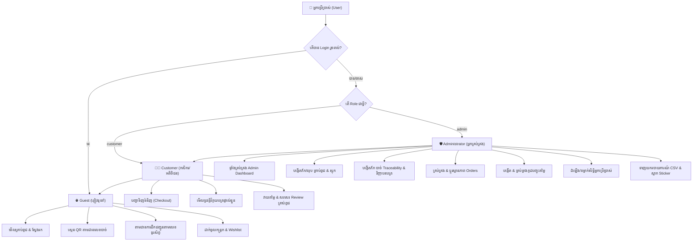

# 👥 តួនាទី និងសិទ្ធិប្រើប្រាស់ (Roles & Permissions - RBAC)
### Smart Agro-Seed Marketplace (Grow2Growth)

---

## ១. ទិដ្ឋភាពទូទៅនៃប្រព័ន្ធគ្រប់គ្រងសិទ្ធិ (RBAC Overview)

ប្រព័ន្ធអនុវត្តនូវគោលការណ៍ **Role-Based Access Control (RBAC)** យ៉ាងតឹងរ៉ឹង ដោយបែងចែកអ្នកប្រើប្រាស់ជា **៣ កម្រិត (Levels)**៖
1. **ភ្ញៀវទូទៅ (Guest / Unauthenticated User)**
2. **អតិថិជន / កសិករ (Customer / Registered Farmer)**
3. **អ្នកគ្រប់គ្រងប្រព័ន្ធ (System Administrator / Co-op Manager)**



---

## ២. តារាងម៉ាទ្រីសសិទ្ធិប្រើប្រាស់ (Permissions Matrix)

| មុខងារ និងប្រតិបត្តិការ (Feature / Action) | ភ្ញៀវ (Guest) | អតិថិជន (Customer) | អ្នកគ្រប់គ្រង (Admin) |
|---|:---:|:---:|:---:|
| **មើលទំព័រដើម និងស្វែងរកគ្រាប់ពូជ** |  |  |  |
| **ស្កេន និងតាមដានលេខបាច់ QR (Traceability)** |  |  |  |
| **តាមដានការដឹកជញ្ជូនសាធារណៈ (Public Order Tracking)** |  |  |  |
| **ប្រើប្រាស់ម៉ាស៊ីនគណនាគ្រាប់ពូជ (Land Calculator)** |  |  |  |
| **ដាក់ទំនិញចូលកន្ត្រក & Wishlist (Session-based)** |  |  |  |
| **អនុវត្ត និងដកកូដបញ្ចុះតម្លៃក្នុងកន្ត្រក (Coupons)** |  |  |  |
| **ចូលទំព័រទូទាត់ប្រាក់ និងបញ្ជាទិញ (Checkout)** | ❌ (តម្រូវឱ្យ Login) |  |  |
| **មើលប្រវត្តិវិក្កយបត្រផ្ទាល់ខ្លួន (My Orders History)** | ❌ |  |  |
| **សរសេរមតិ និងវាយតម្លៃផ្កាយលើគ្រាប់ពូជ (Reviews)** | ❌ |  |  |
| **ចូលផ្ទាំងគ្រប់គ្រងទូទៅ (Admin Dashboard)** | ❌ | ❌ |  |
| **បន្ថែម កែសម្រួល និងលុបគ្រាប់ពូជ (Manage Seeds)** | ❌ | ❌ |  |
| **កែសម្រួលតម្លៃ និងស្តុកគ្រាប់ពូជម្តងទាំងអស់ (Bulk Seeds)**| ❌ | ❌ |  |
| **បង្កើត និងគ្រប់គ្រងបាច់ Traceability (Batch Records)** | ❌ | ❌ |  |
| **ប្តូរស្ថានភាពបញ្ជាទិញ (Order Status Transitions)** | ❌ | ❌ |  |
| **បង្កើត និងគ្រប់គ្រងកូដបញ្ចុះតម្លៃ (Manage Coupons)** | ❌ | ❌ |  |
| **គ្រប់គ្រង និងប្តូរសិទ្ធិអតិថិជន (Customer Role Toggle)** | ❌ | ❌ |  |
| **ទាញយករបាយការណ៍ CSV (Export Orders/Seeds CSV)** | ❌ | ❌ |  |
| **បោះពុម្ពស្លាក Sticker គ្រាប់ពូជ (Print Packaging Labels)** | ❌ | ❌ |  |
| **បោះពុម្ពបញ្ជីរៀបចំវេចខ្ចប់ទំនិញ (Daily Packing Manifest)** | ❌ | ❌ |  |
| **កំណត់ព័ត៌មានទូទៅសហគមន៍ & ប្រព័ន្ធ (Admin Settings)** | ❌ | ❌ |  |

---

## ៣. ការអនុវត្តបច្ចេកទេសក្នុងកូដ (Technical Implementation)

### ៣.១ ស្រទាប់ Middleware ការពារ Route Admin (`AdminMiddleware`)
ឯកសារ៖ `app/Http/Middleware/AdminMiddleware.php`
```php
public function handle(Request $request, Closure $next): Response
{
    if (Auth::check() && Auth::user()->role === 'admin') {
        return $next($request);
    }

    return redirect('/')->with('error', 'លោកអ្នកគ្មានសិទ្ធិចូលទៅកាន់ផ្នែកគ្រប់គ្រងនេះឡើយ!');
}
```

### ៣.២ ការដំឡើង និងទម្លាក់សិទ្ធិអ្នកប្រើប្រាស់ (Promote / Demote User Role)
* អ្នកគ្រប់គ្រង (Admin) អាចចូលទៅកាន់ទំព័រ `/admin/customers` ដើម្បីមើលបញ្ជីសមាជិកទាំងអស់។
* តាមរយៈប៊ូតុង **"ប្តូរសិទ្ធិ (Toggle Role)"** Admin អាចផ្លាស់ប្តូរតួនាទីរបស់ User រវាង `customer` និង `admin` ភ្លាមៗដោយសុវត្ថិភាព។
* ប្រព័ន្ធមាន Safeguard ការពារមិនឱ្យ Admin ច្រឡំទម្លាក់សិទ្ធិគណនីផ្ទាល់ខ្លួនរបស់គាត់ឡើយ (Self-demotion prevention)។

---

## ៤. ដំណើរជីវិតរបស់អ្នកប្រើប្រាស់ (User Journeys)

### Journey A: កសិករថ្មី (New Farmer Journey)
1. ចូលមកកាន់ Homepage មើលគ្រាប់ពូជ និងប្រើប្រាស់ **ម៉ាស៊ីនគណនាគ្រាប់ពូជតាមទំហំដី**។
2. ចុចជ្រើសរើសគ្រាប់ពូជដែលត្រូវចិត្តដាក់ចូលកន្ត្រក (`Add to Cart`)។
3. ចូលទៅកាន់ទំព័រកន្ត្រកទំនិញ វាយបញ្ចូលកូដបញ្ចុះតម្លៃ (`GROW2026`) ដើម្បីទទួលបានការបញ្ចុះតម្លៃ។
4. ចុច "បន្តទៅកាន់ការទូទាត់" ប្រព័ន្ធនឹងស្នើសុំឱ្យ Login ឬចុះឈ្មោះគណនីថ្មីក្នុងរយៈពេលត្រឹមតែ ៣០ វិនាទី។
5. បំពេញអាសយដ្ឋានដឹកជញ្ជូន និងលេខទូរស័ព្ទ រួចចុច "បញ្ជាក់ការបញ្ជាទិញ"។
6. ទទួលបានលេខវិក្កយបត្រ (Order ID) និងអាចតាមដានការដឹកជញ្ជូនបានតាមទូរស័ព្ទ។

### Journey B: អ្នកគ្រប់គ្រងសហគមន៍ (Co-op Manager Journey)
1. ចូលប្រើប្រាស់គណនី Admin ប្រព័ន្ធនឹងនាំទៅកាន់ `/admin/dashboard` ដោយស្វ័យប្រវត្ត។
2. ពិនិត្យមើល Alert គ្រាប់ពូជជិតផុតកំណត់ និងចំនួនការកម្ម៉ង់ដែលរង់ចាំការពិនិត្យ (Pending Orders)។
3. បោះពុម្ព **"បញ្ជីរៀបចំវេចខ្ចប់ទំនិញប្រចាំថ្ងៃ (Daily Packing Manifest)"** ឱ្យផ្នែកឃ្លាំងរៀបចំកញ្ចប់គ្រាប់ពូជ។
4. ប្តូរស្ថានភាព Order ទៅជា `shipping` និងបំពេញលេខកូដដឹកជញ្ជូនជូនកសិករ។
5. បន្ថែមបាច់គ្រាប់ពូជថ្មីដែលទើបប្រមូលផលរួច និងទាញយកវិញ្ញាបនបត្រ QR Code ដើម្បីបិទលើកញ្ចប់ទំនិញ។

